# Tab: Pools overview

# Pools

**Where:** Sidebar › **Pools** 

**Purpose:** A pool is a group of talents linked to a board. Here you find every pool you can see and open one to manage its talents.

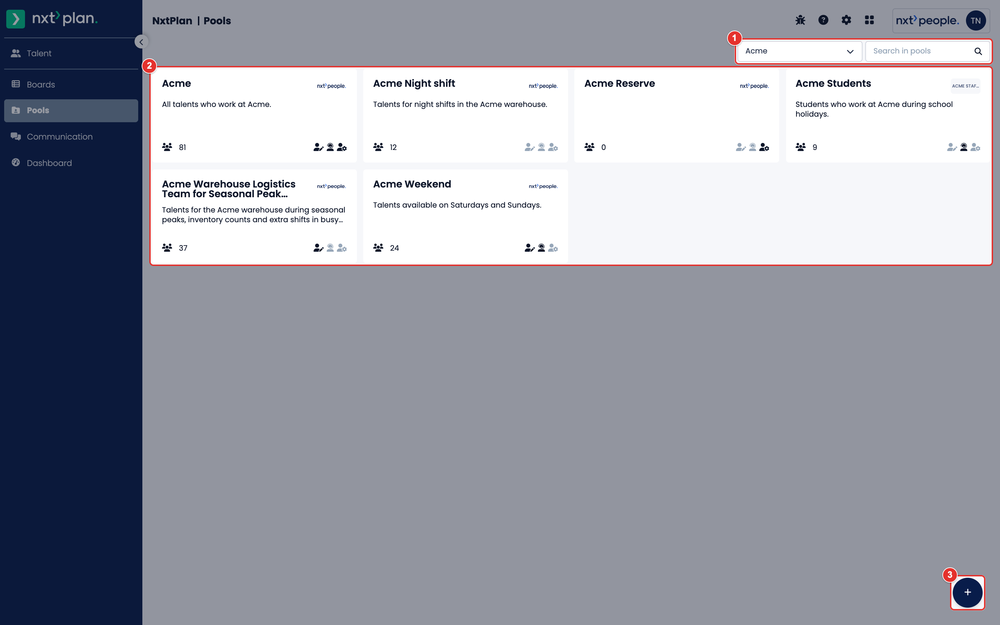

## What you see

- **Filters** ①: the board, and **Search in pools**.
- **Pool cards** ②: one card per pool, sorted by name. Click a card to open the pool → [Pool details](https://file+.vscode-resource.vscode-cdn.net/Users/tamara.neshkovska/Downloads/NXTPLAN/docs/pools/02-pool-details.md).
- **+** ③ (bottom right): add a new pool.

When you open **Pools** from the sidebar, the board you have open is selected in the board filter. You only see that board's pools.

## A pool card

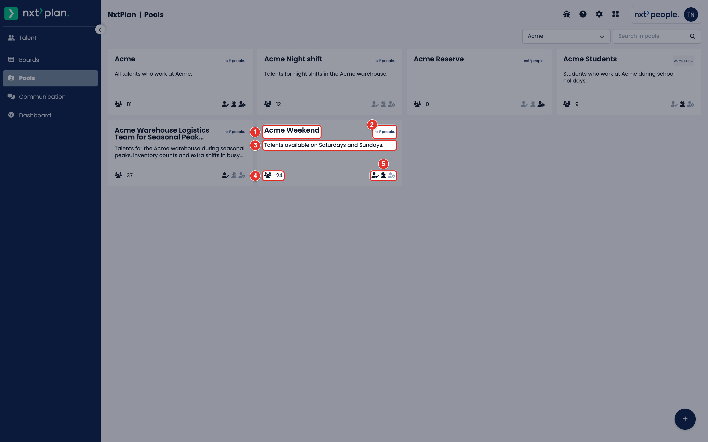

|  | Shows |
| --- | --- |
| ① | Pool name |
| ② | Logo of the company that owns the pool. Hover it to see the company name |
| ③ | Description |
| ④ | Number of talents in the pool. Talents removed from the pool aren't counted |
| ⑤ | Your rights on this pool → [Your rights on a pool](https://file+.vscode-resource.vscode-cdn.net/Users/tamara.neshkovska/Downloads/NXTPLAN/docs/pools/01-pools-overview.md#your-rights-on-a-pool) |

A card can also look like this:

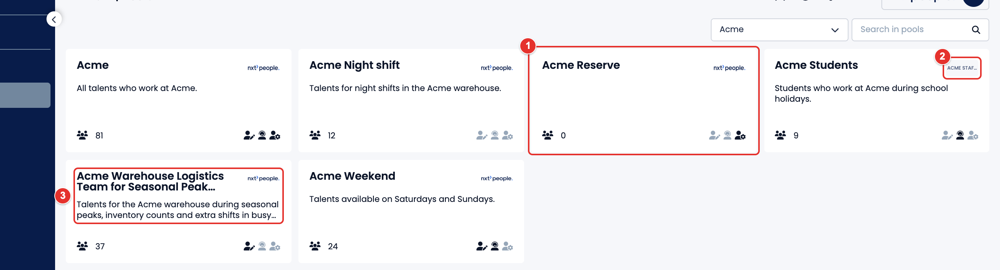

- ① No description: the space stays empty. A new pool without talents shows **0**.
- ② A pool owned by another company that shares it with you: you see that company's logo. A company without a logo shows its name in capitals, cut off when it's long.
- ③ A long name or description is cut off after two lines with "…".

Hover the logo to see the full company name:

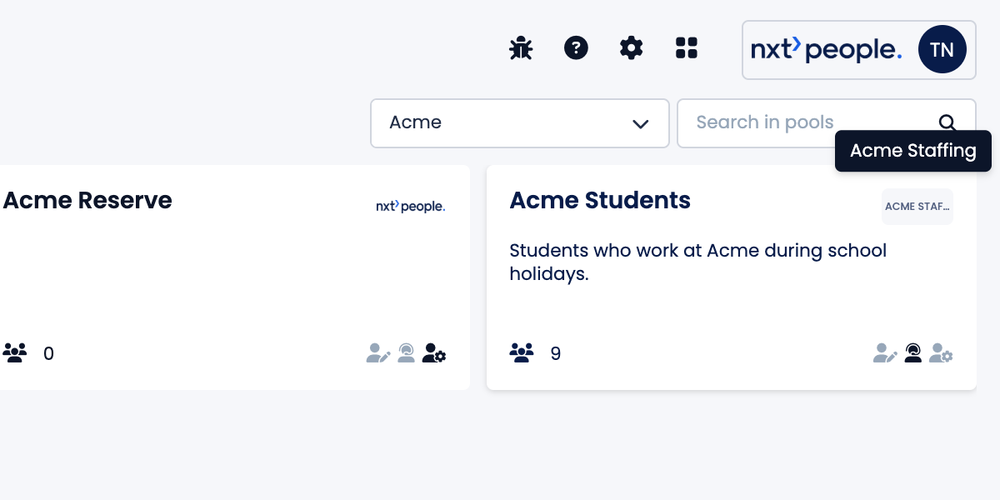

## Your rights on a pool

A pool has four rights: **View**, **Manage Pool**, **Send Communications** and **Admin**. You only see a pool if you have **View**, so the card shows icons for the other three. A **dark** icon means you have that right on this pool, a **grey** icon means you don't.

The three icons are independent, so any combination is possible. Some examples:

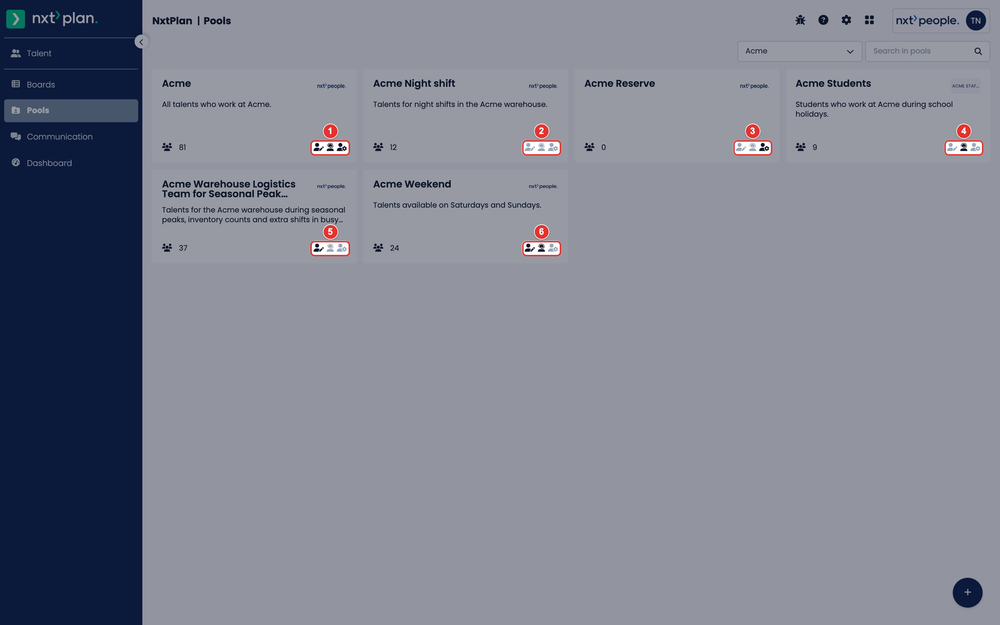

- ① All three rights.
- ② None of the three: you can only view the pool.
- ③ Only **Admin**.
- ④ Only **Communication**.
- ⑤ Only **Manage candidates in pool**.
- ⑥ **Manage candidates in pool** and **Communication**.

Super admins always see all three icons dark.

| Icon (hover text) | Right (in Pool settings › **Permissions**) | What it allows |
| --- | --- | --- |
| **Manage candidates in pool** | **Manage Pool** | Add, remove, move and copy talents. Tags and colour codes, activation, **Check availability**, import, fixed schedules |
| **Communication** | **Send Communications** | Send a **Free message** to the pool's talents |
| **Admin** | **Admin** | Change the pool settings (general information, contracts, availability requests) and permissions |

Each right stands on its own: **Admin** doesn't include the other two.

Hover an icon to see its name:

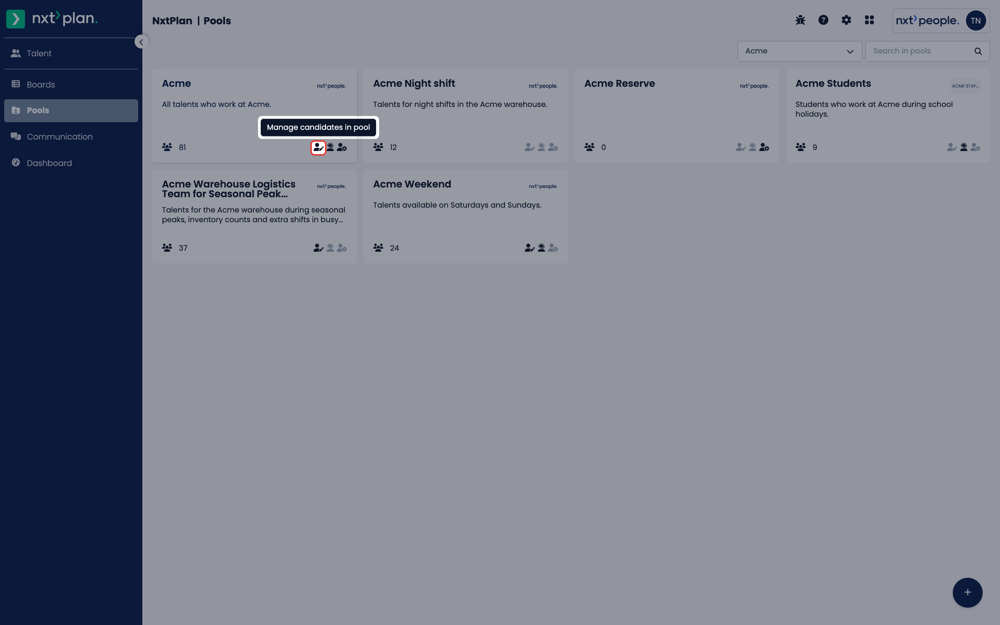

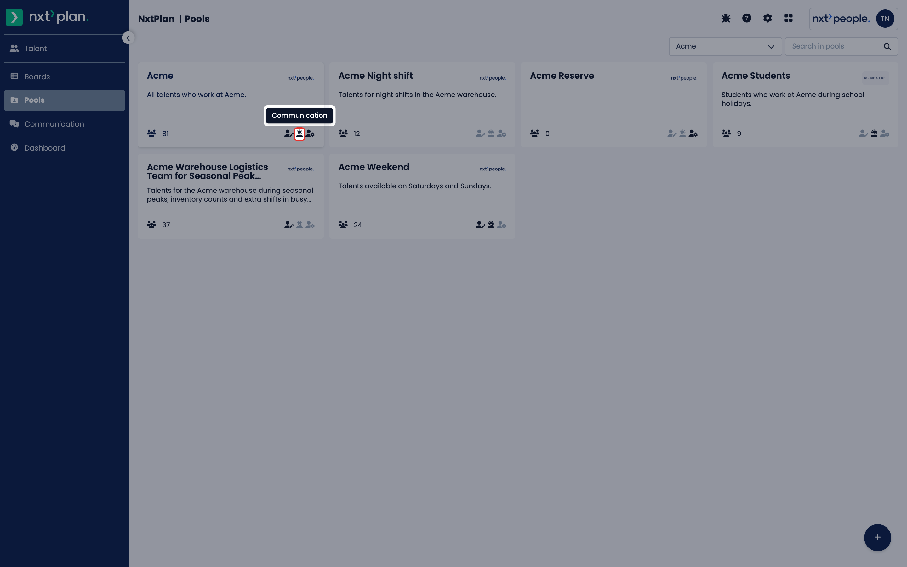

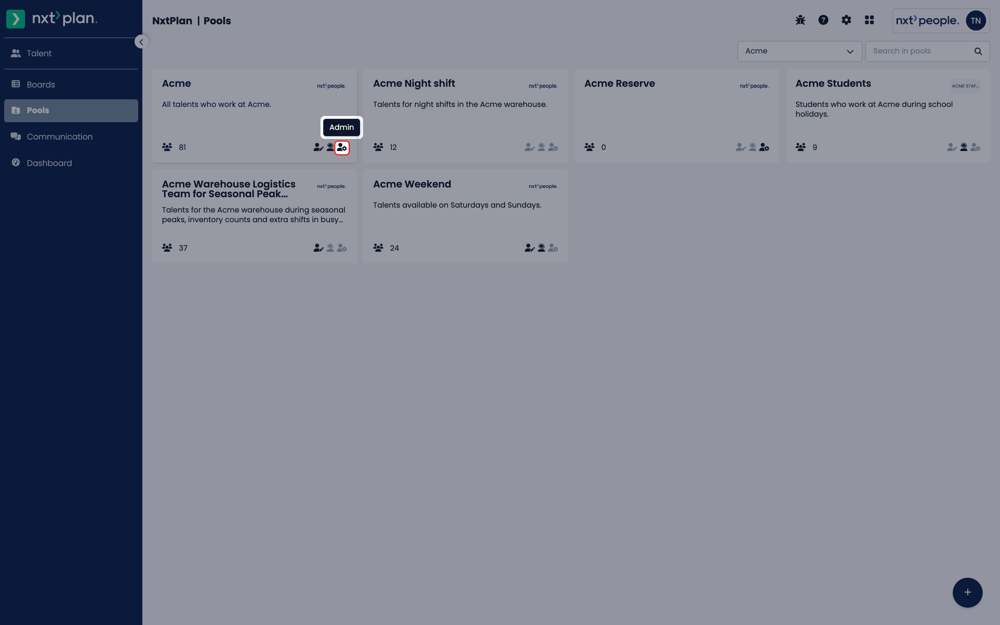

Missing a right? Ask the pool's admin. More on rights: [Who sees what](https://file+.vscode-resource.vscode-cdn.net/Users/tamara.neshkovska/Downloads/NXTPLAN/docs/00-who-sees-what.md).

## Find a pool

| Filter | Use it to |
| --- | --- |
| Board | Show only the pools of one board. Click it and type part of the board name |
| **Search in pools** | Find pools by name, description, company name or pool number (ID) |

**Board filter**, after typing part of the board name:

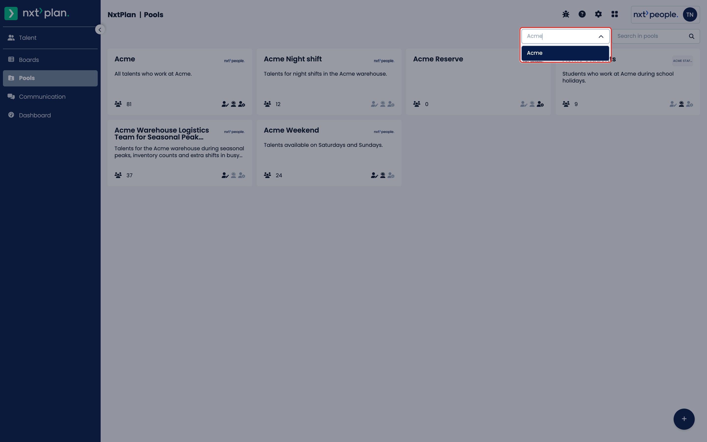

**Search in pools** ① for "weekend" shows only the matching pool ②:

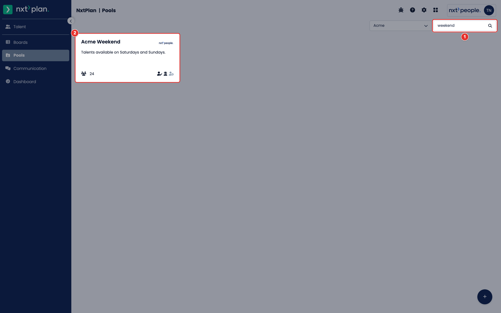

No match? The page says "No pools found. Click **here** to clear the entered search query." Clicking **here** clears the search. The board filter stays.

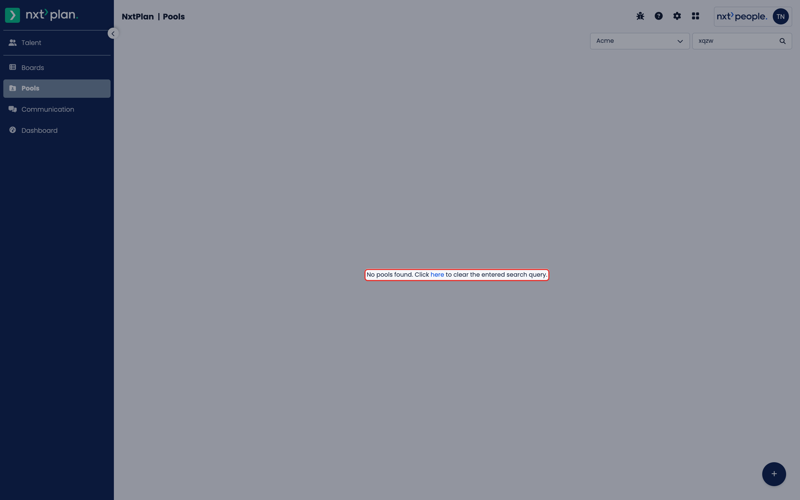

## Add a pool

Click **+** (bottom right). The **Add pool** window opens.

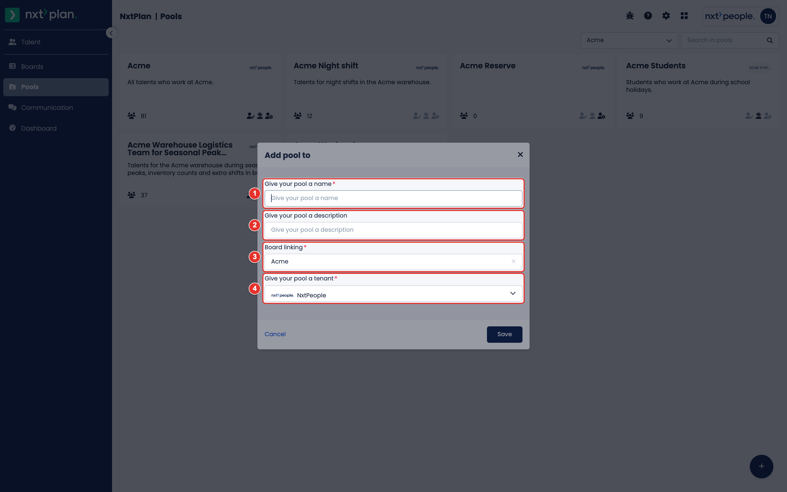

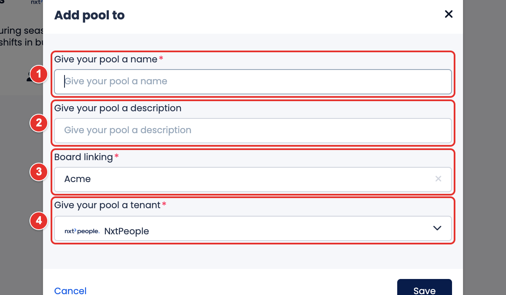

| Field |  |
| --- | --- |
| **Give your pool a name** ① | Required, up to 100 characters. Each name can be used only once per company |
| **Give your pool a description** ② | Optional, up to 280 characters |
| **Board linking** ③ | Required. The board the pool belongs to. The selected board is filled in. The list shows every board you can view, but you can only save with the **Admin** right on the chosen board |
| **Give your pool a tenant** ④ | Required. The company that owns the pool. You can only pick a company that takes part in the board. With one company it is filled in |

Click **Save** to create the pool. The new pool opens.

- You get all rights on the new pool.
- Colleagues and teams of the pool's company that have a right on the board get **View** on the new pool. Other rights must be given in Pool settings › **Permissions**.

Click **Cancel** to close without saving. If you see **Don't save changes?**, click **Do not save** to close, or **Continue editing** to go back.

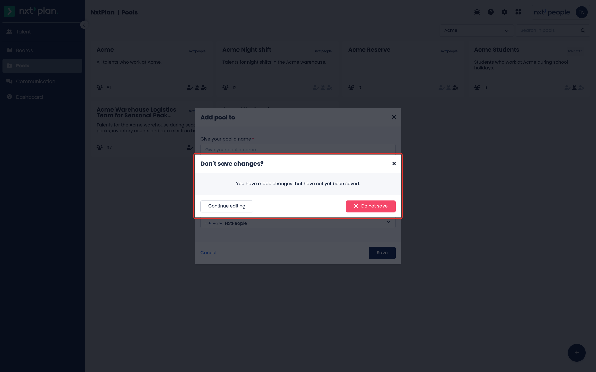

## Who sees this

- The **Pools** item shows in the sidebar for super admins and for everyone with a right on at least one pool.
- You see the pools where you have the **View** right. Super admins see all pools.
- The **+** button shows for super admins and users with the **Create board** right. To save the pool you also need **Admin** on the board you link it to.
- More on rights and companies: [Who sees what](https://file+.vscode-resource.vscode-cdn.net/Users/tamara.neshkovska/Downloads/NXTPLAN/docs/00-who-sees-what.md).

## On a phone

The filters are at the top and the cards are stacked, one per row. **+** is at the bottom right, above the menu bar.

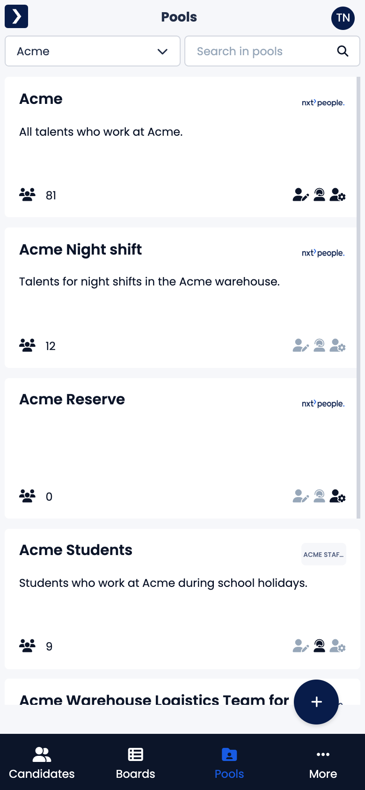

## Good to know

- Only the first 40 pools (by name) are shown. With more pools, use the board filter or **Search in pools** to find the one you need.
- The board filter can't be emptied here. To see another board's pools, pick that board.
- You can't delete a pool from NxtPlan.
